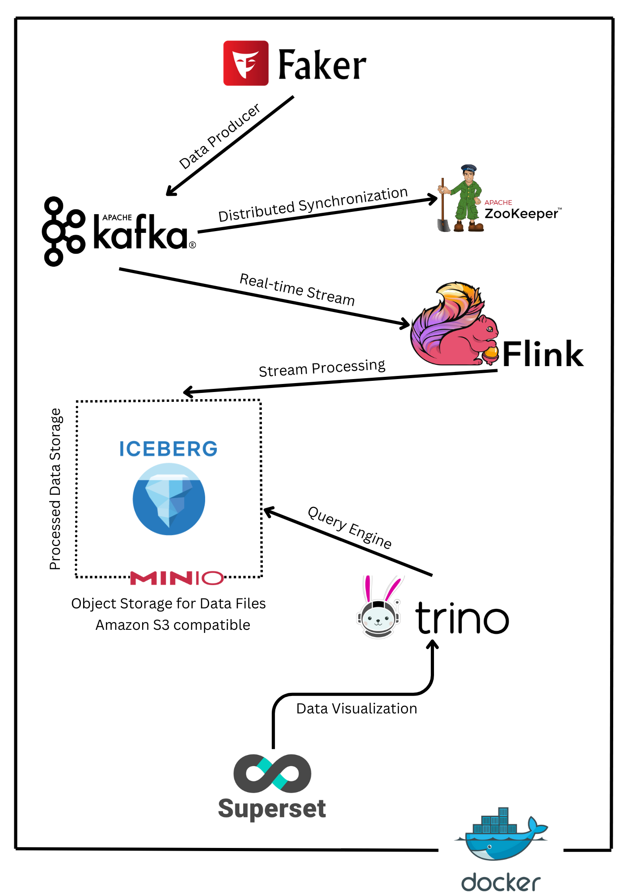
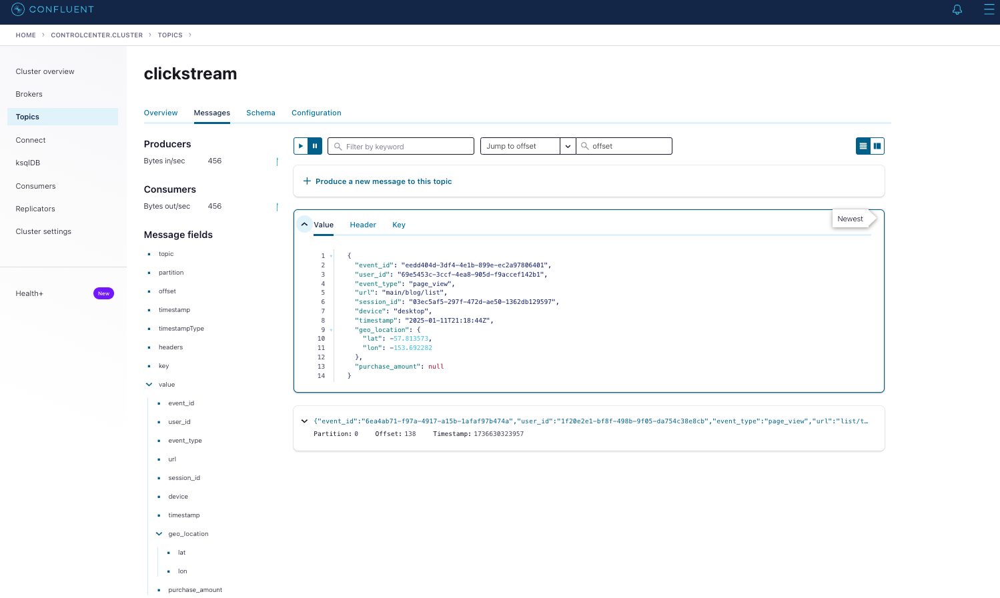
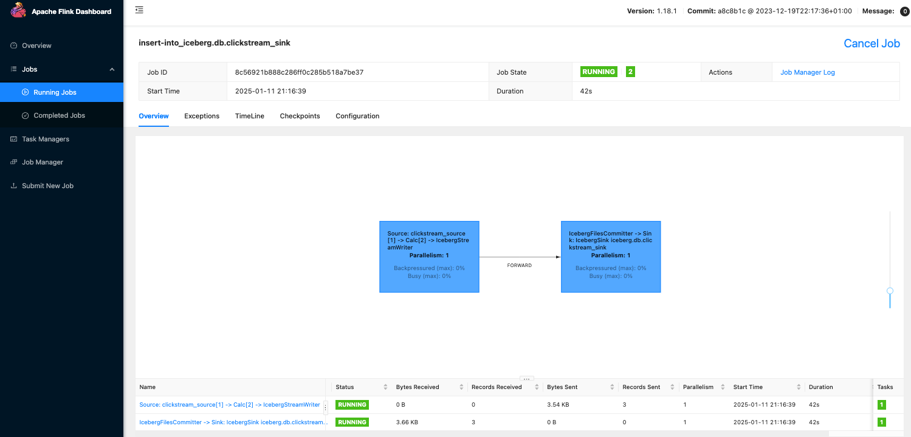
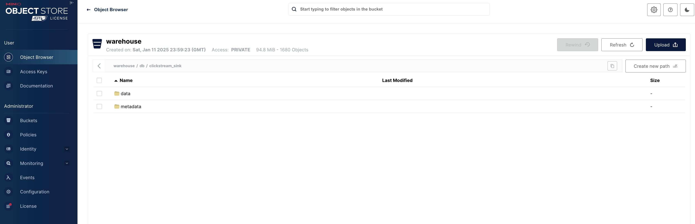
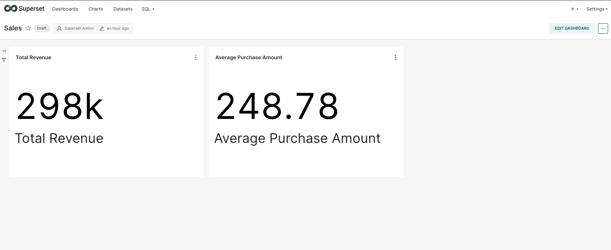

**E2E Real-Time Data Pipeline with Kafka, Flink, Iceberg, Trino, MinIO, and Superset**
======================================================================================


**📖 Overview**
---------------

This project demonstrates a **real-time end-to-end (E2E) data pipeline** designed to handle clickstream data. It shows how to ingest, process, store, query, and visualize streaming data using open-source tools, all containerized with Docker for easy deployment.

🔎 **Technologies Used:**

-   **Data Ingestion:** [Apache Kafka](https://kafka.apache.org/)  
-   **Stream Processing:** [Apache Flink](https://flink.apache.org/)  
-   **Object Storage:** [MinIO (S3-compatible)](https://min.io/)
-   **Data Lake Table Format:** [Apache Iceberg](https://iceberg.apache.org/)  
-   **Query Engine:** [Trino](https://trino.io/)  
-   **Visualization:** [Apache Superset](https://superset.apache.org/)    


This pipeline is perfect for **data engineers** and **students** interested in learning how to design real-time data systems.

* * * * *

**🏗  Architecture**
-----------------------------------



1.  **Clickstream Data Generator** simulates real-time user events and pushes them to **Kafka** topic.
2.  **Apache Flink** processes Kafka streams and writes clean data to **Iceberg tables** stored on **MinIO**.
3.  **Trino** connects to Iceberg for querying the processed data.
4.  **Apache Superset** visualizes the data by connecting to Trino.


🛠 **Tech Stack**
-----------------

| **Component**       | **Technology**                                                                 | **Purpose**                                     |
|--------------------|-------------------------------------------------------------------------------|-------------------------------------------------|
| **Data Generator**  | [Python (Faker)](https://faker.readthedocs.io/)                              | Simulate clickstream events                      |
| **Data Ingestion**  | [Apache Kafka](https://kafka.apache.org/)                                    | Real-time event streaming                        |
| **Coordination Service** | [Apache ZooKeeper](https://zookeeper.apache.org/) | Kafka broker coordination and metadata management |
| **Stream Processing** | [Apache Flink](https://flink.apache.org/)                                  | Real-time data processing and transformation     |
| **Data Lake Storage** | [Apache Iceberg](https://iceberg.apache.org/)                               | Data storage and schema management              |
| **Object Storage**  | [MinIO](https://min.io/)                                                      | S3-compatible storage for Iceberg tables         |
| **Query Engine**    | [Trino](https://trino.io/)                                                    | Distributed SQL querying on Iceberg data         |
| **Visualization**   | [Apache Superset](https://superset.apache.org/)                               | Interactive dashboards and data visualization    |

* * * * *


**📦 Project Structure**
------------------------

```bash
e2e-data-pipeline/
├── docker-compose.yml          # Docker setup for all services
├── layering/                   # 统一契约包（Python 3.11）：四张 Iceberg 表 schema、
│                               #   event_type 白名单、四类脏数据判定的唯一事实来源
│   ├── contract.py             #   表/列定义、白名单、reject_reason、时间格式常量
│   ├── validation.py           #   validate_record()：四类脏数据判定
│   ├── catalog.py              #   解析 trino/iceberg.properties
│   ├── sql.py                  #   render_flink_sql()：渲染 Flink 作业
│   └── tests/                  #   pytest 契约测试
├── flink/                      # Flink SQL client and streaming jobs
│   └── sql-jobs/clickstream_layering.sql  # 由 render_flink_sql() 生成，勿手改
├── producer/                   # 双 sink 生成器（Kafka + JSONL），import layering
├── scripts/offline_validate.py # 离线校验，复用同一份 validate_record
├── superset/                   # Superset setup and configuration
└── trino/                      # Trino 配置与核对脚本（verify_layering.sql）
```

> **契约收拢**：Flink 作业、producer、离线脚本只允许 `import layering`，对外接口只有
> `validate_record()` 和 `render_flink_sql()` 两个。改白名单或脏数据规则只需改
> `layering/contract.py`，再重新渲染 SQL，三处口径不会再漂移。

* * * * *

**🔧 Setup Instructions**
-------------------------

### **1\. Prerequisites**

-   **Docker** and **Docker Compose** installed.
-   Minimum **16GB RAM** recommended.

### **2\. Clone the Repository**

```bash
git clone https://github.com/abeltavares/real-time-data-pipeline.git
cd real-time-data-pipeline
```

### **3\. Start All Services**

```bash
docker-compose up -d
```

⚠️ **Note:** All components (Kafka, Flink, Iceberg, Trino, MinIO, and Superset) are containerized using Docker for easy deployment and scalabilit

### **4\. Access the Services**

| **Service** | **URL** | **Credentials** |
| --- | --- | --- |
| **Kafka Control Center** | `http://localhost:9021` | *No Auth* |
| **Flink Dashboard** | `http://localhost:18081` | *No Auth* |
| **MinIO Console** | `http://localhost:9001` | `admin` / `password` |
| **Trino UI** | `http://localhost:8080/ui` | *No Auth* |
| **Superset** | `http://localhost:8088` | `admin` / `admin` |


📥 **Data Ingestion**
---------------------

### 1\. **Clickstream Data Generation**

Clickstream events are simulated using Python's **Faker** library. The generator is a
**finite dual-sink** job that produces exactly 50 records: 42 valid (including 2 duplicated
`event_id` groups and a user with three profile versions) plus 8 dirty records covering all
four `reject_reason` classes, two each. It imports every rule from the `layering` package.

```python
{
  "event_id": "evt-001",
  "user_id": "user-01",
  "event_type": "page_view",            # 白名单：page_view/add_to_cart/purchase/logout
  "url": "/home",
  "session_id": "sess-001",
  "device": "mobile",
  "event_time": "2026-11-10T08:00:00Z", # canonical 格式，契约内统一定义
  "geo_location": {"lat": 30.0, "lon": 120.0},
  "purchase_amount": null
}
```

Sinks:

- **Kafka + JSONL** when `KAFKA_BROKER` is set and `confluent_kafka` is installed
  (the Kafka client is imported lazily, only inside the send branch).
- **JSONL only** otherwise — the MQ dependency is optional, offline validation still works.

Run it locally without any MQ stack:

```bash
python producer/producer.py            # 写 clickstream_samples.jsonl
python scripts/offline_validate.py     # 用同一份 layering.validate_record 离线对账
```

The four dirty-data classes (single source of truth in `layering/contract.py`):

| reject_reason            | 判定                                             |
|--------------------------|--------------------------------------------------|
| MISSING_REQUIRED_FIELD   | 必填字段缺失或空白                               |
| INVALID_EVENT_TIME       | event_time 形状不符或日历非法，watermark 前隔离 |
| INVALID_EVENT_TYPE       | event_type 不在白名单                            |
| INVALID_GEO_LOCATION     | geo_location 缺失/非数值/经纬度越界             |

### 2\. **Kafka Consumer**

The Kafka consumer reads the clickstream events and pushes them to **Apache Flink** for real-time processing.

You can monitor the Kafka topic through the **Kafka Control Center**:

-   **Kafka Control Center URL:** <http://localhost:9021>



* * * * *

⚡ **Real-Time Data Processing with Apache Flink**
-------------------------------------------------

### 1\. **Flink Configuration**

-   **State Backend:** RocksDB
-   **Checkpointing:** Enabled for fault tolerance
-   **Connectors:** Kafka → Iceberg (via Flink SQL)

### 2\. **Flink SQL Job Execution**

The `sql-client` service submits the layered job after the JobManager and TaskManager are
running. The SQL file is **generated, never hand-edited** — regenerate it after any contract
change so the job and the Python rules cannot drift:

```bash
python -c "from layering import render_flink_sql; render_flink_sql()"
# 产出 flink/sql-jobs/clickstream_layering.sql（compose 已挂载该文件）
```

Job topology:

- Kafka source keeps `event_time` as a raw STRING; bad timestamps are classified and
  isolated **before the watermark** (bad rows compute to NULL and never advance the
  watermark, so they cannot stall it or distort the `event_id` dedup ordering).
- `iceberg.ods.clickstream` — append-only, every source row written as-is.
- `iceberg.ods.clickstream_dirty` — dirty rows with `reject_reason` + `raw_payload`,
  nothing is silently dropped.
- `iceberg.dwd.clickstream_dedup` — clean stream deduped by `event_id` (first row wins),
  Iceberg v2 UPSERT.
- `iceberg.dim.dim_user` — latest profile per `user_id` (last row by `event_time`),
  Iceberg v2 UPSERT.
- The Iceberg catalog/warehouse options are parsed from `trino/iceberg.properties`,
  so Flink and Trino always point at the same REST catalog and warehouse.

```bash
/opt/flink/bin/sql-client.sh -f /opt/flink/clickstream_layering.sql
```

### 2\. **Flink Dashboard**

Monitor real-time data processing jobs at:\
📊 http://localhost:18081



* * * * *

🗄️ **Data Lakehouse with Apache Iceberg**
------------------------------------------

Processed data from Flink is stored in **Iceberg tables** on **MinIO**. This enables:

-   **Efficient Querying** with Trino
-   **Schema Evolution** and **Time Travel**

To list the contents of the MinIO warehouse, you can use the following command:

```bash
docker exec mc bash -c "mc ls -r minio/warehouse/"
```

Alternatively, you can access the MinIO console via the web at <http://localhost:9001>.

-   **Username:** `admin`
-   **Password:** `password`



**🔍 Query Data with Trino**
----------------------------

 **1\. Run Trino CLI**

```bash
docker-compose exec trino trino
```

**2\. 核对分层表（catalog 名取自 `iceberg.properties` 文件名）**

```sql
-- reject_reason 分布：四类各 2 条
SELECT reject_reason, count(*) FROM iceberg.ods.clickstream_dirty GROUP BY 1 ORDER BY 1;

-- event_id 无重复：两个计数必须相等
SELECT count(*), count(DISTINCT event_id) FROM iceberg.dwd.clickstream_dedup;

-- dim_user 取最新 profile：应为 event_time 最晚的 /checkout
SELECT user_id, url, event_time FROM iceberg.dim.dim_user
WHERE user_id = 'user-latest-01';
```

完整核对脚本见 [`trino/verify_layering.sql`](trino/verify_layering.sql)
（含脏表 raw_payload 留存、ODS/dirty/dwd 行数勾稽、UPSERT 主键唯一性检查）。

📊 **Data Visualization with Apache Superset**
----------------------------------------------

1.  **Access Superset:** <http://localhost:8088>

    -   **Username:** `admin`
    -   **Password:** `admin`
2.  **Connect Superset to Trino:**

-   **SQLAlchemy URI:**

    ```bash
    trino://trino@trino:8080/iceberg/ods
    ```
-   **Configure in Superset:**

    1.  Open `http://localhost:8088`
    2.  Go to **Data** → **Databases** → **+**
    3.  Use the above SQLAlchemy URI.

3.  **Create Dashboards:**



🏆 **Key Features**
-------------------

### 🔄 **Real-Time Data Processing**

-   Stream processing with **Apache Flink**.
-   Clickstream events are transformed and filtered in real-time.

### 📂 **Modern Data Lakehouse**

-   Data is stored in **Apache Iceberg** on **MinIO**, S3 compatible, supporting schema evolution and time travel.

### ⚡ **Fast SQL Analytics**

-   **Trino** provides fast, distributed SQL queries on Iceberg data.

### 📊 **Interactive Dashboards**

-   **Apache Superset** delivers real-time visual analytics.

### 📦 **Fully Containerized Setup**

-   Simplified deployment using **Docker** and **Docker Compose** for seamless integration across all services.

* * * * *

📈 **Future Enhancements**
--------------------------

-   Implement **alerting** and **monitoring** with **Grafana** and **Prometheus**.
-   Introduce **machine learning pipelines** for predictive analytics.
-   Optimize **Iceberg partitioning** for faster queries.

* * * * *

**🧪 契约开发与本地验证（无需 Docker/MQ）**
-------------------------------------------

```bash
# 1. 契约单测：白名单、四类脏数据、四表 schema、SQL 渲染不变量
python -m pytest layering/tests -q

# 2. producer 语法检查
python -m py_compile producer/producer.py

# 3. 生成 50 条样例（无 KAFKA_BROKER 自动只写 JSONL）
python producer/producer.py

# 4. 离线对账：复用同一份 validate_record，检测口径漂移
python scripts/offline_validate.py

# 5. 改完 contract.py 后重新渲染 Flink SQL
python -c "from layering import render_flink_sql; render_flink_sql()"
```

对外接口只有两个（`layering/__init__.py` 的 `__all__`）：

```python
from layering import validate_record, render_flink_sql
```

* * *

📎 **Quick Reference Commands**
-------------------------------

| **Component** | **Command** |
| --- | --- |
| **Start Services** | `docker-compose up --build -d` |
| **Stop Services** | `docker-compose down` |
| **View Running Containers** | `docker ps` |
| **Check Logs** | `docker-compose logs -f` |
| **Rebuild Containers** | `docker-compose up --build --force-recreate -d` |

* * * * *

🙌 **Get Involved**
-------------------

Contributions are welcome! Feel free to submit issues or pull requests to improve this project.

* * * * *

📜 License
--------------

This project is licensed under the [MIT License](LICENSE).

* * * * *

Enjoy exploring real-time data pipelines!